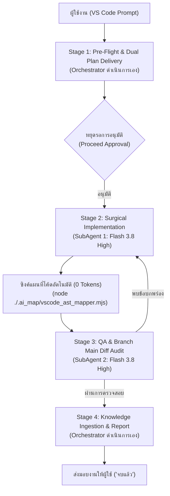

# คู่มือการตั้งค่าและใช้งาน Lean AI Workflow ในโปรเจกต์จริงบน VS Code
(Lean 2-SubAgent + 1-Orchestrator Architecture)

คู่มือนี้จัดทำขึ้นเพื่อเป็นแนวทางปฏิบัติมาตรฐานสำหรับการพัฒนาและปรับปรุงซอฟต์แวร์บน Visual Studio Code ด้วยสถาปัตยกรรม **Lean 2-SubAgent Architecture** ซึ่งปรับลดความซ้ำซ้อนจากระบบเดิม (9 SubAgents / 12 ขั้นตอน) ลงเหลือ 4 ขั้นตอนกระชับ เพื่อประหยัดโทเคนได้สูงสุดถึง ~75% โดยยังคงรักษาความถูกต้อง แม่นยำ และความเข้ากันได้ของระบบไว้ 100%

---

## 1. โครงสร้างสถาปัตยกรรม Lean AI Workflow

### 1.1 Orchestrator (คุณ / Main Agent)
- **โมเดล**: `Flash 3.8 High`
- **หน้าที่หลัก**:
  1. ค้นหาบริบทจากสมองที่สอง (`second_brain_vault/00_INDEX_MOC.md`)
  2. จับคู่สกิลจากคลังสกิล (`ai_skills_registry/SKILL_CATALOG.json`)
  3. ค้นหา Flow ID และชี้เป้าช่วงบรรทัดจาก `.ai_map/` ด้วยตนเอง (Phase 0.3)
  4. สร้างแผนคู่ขนาน: `implementation_plan.md` artifact (เปิด `RequestFeedback: true`) และ `interactive_plan.html`
  5. **หยุดรอผู้ใช้กด Proceed อนุมัติ** ก่อนเริ่มแก้ไขไฟล์
  6. ส่งต่องานและควบคุม SubAgents ทั้ง 2 ตัว
  7. สกัดสกิลใหม่และบันทึกความรู้กลับเข้าสมองที่สอง (Phase 6) พร้อมทำรายงานสรุปส่งมอบงาน

### 1.2 SubAgent 1 (`subagent_01_implementer`)
- **โมเดล**: `Flash 3.8 High` (จำนวน 1 ตัว)
- **หน้าที่หลัก**:
  1. เปิดอ่านเฉพาะช่วงบรรทัดเป้าหมาย (`StartLine`–`EndLine` ± 10 บรรทัด) ตามที่แผนกำหนด
  2. **กฎเหล็ก**: "แก้ไขเฉพาะส่วนที่ต้องแก้ไข, ไม่แก้ไขส่วนที่ไม่เกี่ยวข้อง" (`STRICT_SURGICAL_SCOPE_ONLY`)
  3. เขียนโค้ดจริงครบ 100% ห้ามมี Placeholder หรือคอมเมนต์ละโค้ด (`NO_PLACEHOLDERS_IN_TARGET_SCOPE`)
  4. รันคำสั่ง `node ./.ai_map/vscode_ast_mapper.mjs` ทันทีหลังแก้ไขโค้ดเสร็จ เพื่ออัปเดตสารบัญ `.ai_map/` ให้ตรงกับไฟล์จริง

### 1.3 SubAgent 2 (`subagent_02_qa_auditor`)
- **โมเดล**: `Flash 3.8 High` (จำนวน 1 ตัว)
- **หน้าที่หลัก**:
  1. ตรวจสอบโค้ดที่แก้ไขเทียบกับข้อกำหนดในแผนงานทุกข้อ
  2. ตรวจสอบไวยากรณ์ด้วย `node --check` และรันทดสอบฟังก์ชัน
  3. ตรวจสอบความแตกต่างเทียบกับ Branch `main` ด้วยคำสั่ง `git diff main` เพื่อยืนยันความเข้ากันได้ และตรวจว่าไม่มีการแก้ไขกระทบส่วนที่ไม่เกี่ยวข้อง

---

## 2. นโยบายสำคัญระดับระบบ (Strict System Policies)

1. **ห้ามรัน `git push` เด็ดขาด**: ป้องกันการส่งโค้ดขึ้น Repository โดยที่ผู้ใช้ยังไม่ได้ตรวจสอบด้วยตนเอง
2. **ห้ามอ่านไฟล์เต็มเกิน 80 บรรทัด**: บังคับใช้นโยบาย `MAP_FIRST_SURGICAL_LINE_RANGE_ONLY` ต้องดูสารบัญ `.ai_map/` ก่อนเสมอ
3. **ห้ามแก้ไขส่วนที่ไม่เกี่ยวข้อง**: ยึดถือนโยบาย `STRICT_SURGICAL_SCOPE_ONLY` อย่างเคร่งครัด
4. **ห้ามใช้โมเดลต่ำกว่ามาตรฐาน**: บังคับใช้ `Flash 3.8 High` สำหรับทุกตัว ห้ามใช้ `flash_lite`

---

## 3. แหล่งเก็บความรู้และเครื่องมือหลัก

- **แผนที่โค้ดเบส (`.ai_map/`)**:
  - `00_PROCESS_FLOW_MAP.md`: แผนผังเส้นทางการทำงานและ Call Chain
  - `01_FILE_FUNCTION_INDEX.md`: ดัชนีฟังก์ชันและเลขบรรทัด `L_start - L_end`
  - `CODE_INDEX.json`: ข้อมูล AST และ SHA-256 Hashes
  - `vscode_ast_mapper.mjs`: สคริปต์สแกนโค้ดสร้างแผนที่แบบ 0 AI tokens
- **สมองที่สอง (`second_brain_vault/`)**:
  - `00_INDEX_MOC.md`: สารบัญใหญ่เชื่อมโยงเอกสารสถาปัตยกรรมและกฎธุรกิจ
- **คลังสกิล (`ai_skills_registry/`)**:
  - `SKILL_CATALOG.json`: ทะเบียนบันทึกสกิลที่พร้อมใช้งาน
