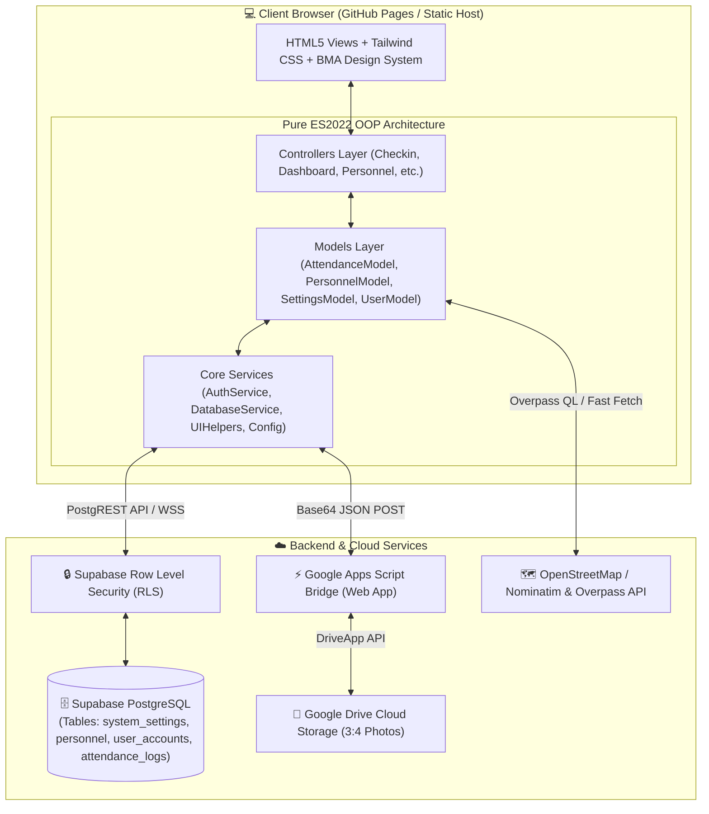
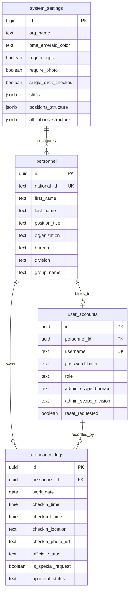

<div align="center">

# 🏛️ ระบบลงเวลาปฏิบัติราชการออนไลน์ กรุงเทพมหานคร
### BMA Check-in Application (Enterprise Edition v2.10.0 — OOP Architecture)

[](https://opensource.org/licenses/MIT)
[](./assets/js/)
[](https://supabase.com)
[](./google_apps_script/)
[](https://pages.github.com)
[](#-อัตลักษณ์การออกแบบ-bma-enterprise-design-system)

<p align="center">
  <b>ระบบลงเวลาปฏิบัติราชการออนไลน์ระดับองค์กร พัฒนาด้วยสถาปัตยกรรมเชิงวัตถุ (Pure ES2022 OOP)</b><br>
  ตอบโจทย์ข้าราชการและบุคลากรกรุงเทพมหานคร ด้วยการผสานระบบ GPS Reverse Geocoding อัจฉริยะ 3 ระดับ,<br>
  กล้องบันทึกภาพถ่ายสัดส่วนราชการ 3:4 บนคลาวด์ Google Drive ไร้ค่าใช้จ่าย, การประมวลผลกะทำงานแบบยืดหยุ่น,<br>
  และระบบสิทธิ์แบบหลายระดับ (RBAC Scope Confinement) ภายใต้มาตรฐานความปลอดภัยระดับสูง
</p>

[🌐 เว็บไซต์ลงเวลา](#) • [📖 เอกสารสถาปัตยกรรม](#-สถาปัตยกรรมระบบ-system-architecture) • [🚀 คู่มือการติดตั้ง](#-ขั้นตอนการติดตั้งและตั้งค่าระบบ) • [🗺️ สารบัญโค้ด (.ai_map)](#-ระบบสารบัญโค้ดและการพัฒนา-ai-map--second-brain)

</div>

---

## 📋 สารบัญ (Table of Contents)
- [✨ จุดเด่นและฟีเจอร์สำคัญ (Core Highlights)](#-จุดเด่นและฟีเจอร์สำคัญ-core-highlights)
- [🏛️ อัตลักษณ์การออกแบบ (BMA Enterprise Design System)](#-อัตลักษณ์การออกแบบ-bma-enterprise-design-system)
- [🏗️ สถาปัตยกรรมระบบ (System Architecture)](#-สถาปัตยกรรมระบบ-system-architecture)
- [🔄 กระบวนการทำงานหลัก 12 ขั้นตอน (12 End-to-End Process Flows)](#-กระบวนการทำงานหลัก-12-ขั้นตอน-12-end-to-end-process-flows)
- [📂 โครงสร้างโฟลเดอร์และโมดูล (Project Structure)](#-โครงสร้างโฟลเดอร์และโมดูล-project-structure)
- [💾 โครงสร้างฐานข้อมูล Supabase (Database Schema & RLS)](#-โครงสร้างฐานข้อมูล-supabase-database-schema--rls)
- [🚀 ขั้นตอนการติดตั้งและตั้งค่าระบบ (Deployment & Configuration)](#-ขั้นตอนการติดตั้งและตั้งค่าระบบ-deployment--configuration)
- [🔐 แนวปฏิบัติด้านความปลอดภัย (Security Guidelines)](#-แนวปฏิบัติด้านความปลอดภัย-security-guidelines)
- [🧠 ระบบสารบัญโค้ดและการพัฒนา (AI Map & Second Brain)](#-ระบบสารบัญโค้ดและการพัฒนา-ai-map--second-brain)

---

## ✨ จุดเด่นและฟีเจอร์สำคัญ (Core Highlights)

### 1. ระบบค้นหาพิกัดและจำแนกชื่อสถานที่ GPS 3 ระดับ (Multi-Tier Geocoding)
* **การซูมแบบไดนามิก:** ผสานพลัง OpenStreetMap Overpass API และ Nominatim พร้อมระบบ Local Cache ในตัว
  * **ระดับที่ 1 (z=19 / ระยะ $\le$ 65 ม.):** ระบุสถานที่เฉพาะเจาะจงในรูปแบบ `"ใกล้เคียง <ชื่อสถานที่/อาคาร>"`
  * **ระดับที่ 2 (z=20 / ระยะ 65–160 ม.):** ขยายรัศมีระบุบริเวณโดยรอบในรูปแบบ `"บริเวณ <ชื่อสถานที่/อาคาร>"`
  * **ระดับที่ 3 (ซอย/ซอยย่อย):** หากไม่พบอาคาร จะดึงชื่อตรอก/ซอย/ซอยย่อยมาแสดงผลอัตโนมัติ
* **ระบบกรองคำต้องห้าม:** บล็อกการแสดงชื่อกว้างๆ เช่น `"ถนน"`, `"แขวง"`, `"เขต"`, `"หมู่บ้าน"`, `"ตำบล"`, `"อำเภอ"`, `"จังหวัด"` ไม่ให้ถูกนำมาบันทึกเป็นชื่อสถานที่ เพื่อความแม่นยำสูงสุดในการตรวจสอบ

### 2. กล้องถ่ายภาพสัดส่วน 3:4 และ Serverless Cloud Bridge
* **กล้อง On-Demand ประหยัดพลังงาน:** ระบบจะเปิด Stream กล้องเฉพาะเมื่อผู้ใช้กดถ่ายรูป และปิดกล้องทันทีหลังบันทึกเสร็จ
* **Google Apps Script Bridge:** อัปโหลดรูปภาพแนวตั้ง 3:4 เข้าสู่ Google Drive ประจำหน่วยงานโดยอัตโนมัติ และแปลงเป็น Direct Link จัดเก็บใน Supabase ช่วยประหยัดพื้นที่ฐานข้อมูลและไม่มีค่าใช้จ่ายคลาวด์เพิ่มเติม

### 3. โหมดการลงเวลา 2 รูปแบบ (Flexible Attendance Modes)
* **โหมดปกติ (Standard 2-Click):** ลงเวลาแยกขาเข้าและขาออกตามเวลาจริง
* **โหมดพิเศษ (Single-Click Instant Mode):** กดครั้งเดียวเพื่อลงเวลาพร้อมกันทั้งขาเข้าและขาออก เหมาะสำหรับภารกิจนอกสถานที่หรือการลงเวลารูปแบบพิเศษตามที่ผู้ดูแลระบบกำหนด
* **การประเมินสถานะทางการอัตโนมัติ:** คำนวณสถานะ `ตรงเวลา`, `สาย`, `กลับก่อน`, `รออนุมัติ` และ `ขาดงาน` เทียบกับกะทำงานและช่วงเวลาผ่อนผัน (`grace_minutes`)

### 4. ระบบจัดการข้อมูลบุคลากรและ Excel Engine (ExcelJS)
* **Multi-Sheet Template with Data Validation:** สร้างไฟล์แม่แบบ Excel ที่มี Dropdown ตรวจสอบความถูกต้องจากข้อมูลระบบจริง
* **Cascading Validation:** ตรวจสอบความสอดคล้องของสังกัด 4 ระดับ (สำนัก/กอง > ส่วน/ฝ่าย > กลุ่มงาน) และตำแหน่งแบบเป็นลูกโซ่
* **Fuzzy String Matching:** ใช้อัลกอริทึม Dice Coefficient ช่วยจับคู่ชื่อสังกัดหรือตำแหน่งที่สะกดผิดเพี้ยนในการนำเข้าแบบกลุ่ม

### 5. สิทธิ์ผู้ใช้งานหลายระดับ (Enterprise RBAC & Scope Confinement)
* **SuperAdmin:** ควบคุมการตั้งค่าระบบทั้งหมด กะเวลา โครงสร้างตำแหน่ง และโครงสร้างสังกัด
* **Admin (Scope-Confinable):** ผู้ดูแลระดับกอง/ฝ่าย ที่ถูกจำกัดสิทธิ์การมองเห็นและการอนุมัติเฉพาะบุคลากรในสังกัดของตนเอง (`admin_scope_bureau`, `admin_scope_division`)
* **User:** เข้าใช้งานเฉพาะหน้าลงเวลา ดูประวัติของตนเอง และยื่นคำขอลงเวลาพิเศษ/ย้อนหลัง

---

## 🏛️ อัตลักษณ์การออกแบบ (BMA Enterprise Design System)

แอปพลิเคชันได้รับการออกแบบภายใต้ระบบสีอัตลักษณ์ของกรุงเทพมหานคร มอบประสบการณ์ใช้งานที่ภูมิฐาน ทันสมัย และตอบโจทย์การใช้งานทั้งกลางวันและกลางคืน:

| องค์ประกอบ | โค้ดสี (HEX) | บทบาทและการนำไปใช้งาน |
|:---|:---:|:---|
| **BMA Emerald Green** | `#007B3E` | สีเขียวมรกตประจำกรุงเทพมหานคร ใช้เป็นสีหลัก (Primary), แถบสถานะตรงเวลา และปุ่มสั่งการหลัก |
| **BMA Warm Gold** | `#D4AF37` | สีทองอบอุ่น ใช้เป็นสีรอง (Accent), ลายไทยกราฟิก และสัญลักษณ์สำคัญ |
| **Eye-Care Dark Surface** | `#111816` | โหมดมืดถนอมสายตาโทนเขียวเข้มพิเศษ ลดแสงสะท้อนสำหรับการปฏิบัติงานภาคสนาม |
| **Jewel-Tone Status Palette** | ต่างๆ | ระบบสีอัญมณีแยกสถานะการลงเวลา (ตรงเวลา เขียวมรกต / สาย ส้มอำพัน / กลับก่อน แดงทับทิม) |

---

## 🏗️ สถาปัตยกรรมระบบ (System Architecture)

ระบบถูกออกแบบให้เป็น **Client-Side Heavy (Single Page Experience)** ที่รวดเร็ว ปลอดภัย และไร้ภาระการดูแลเซิร์ฟเวอร์ (Zero-Server-Cost Architecture):



---

## 🔄 กระบวนการทำงานหลัก 12 ขั้นตอน (12 End-to-End Process Flows)

ระบบมีสารบัญกระบวนการทำงานที่ถูกแมปด้วย AST Index ไว้อย่างแม่นยำใน [.ai_map/00_PROCESS_FLOW_MAP.md](./.ai_map/00_PROCESS_FLOW_MAP.md):

| Flow ID | ชื่อกระบวนการ (Process Name) | สายการเรียกใช้งานข้ามไฟล์หลัก (Primary Call Chain) |
|:---|:---|:---|
| `FLOW_AUTH_01` | การยืนยันตัวตน เข้าสู่ระบบ 2 โหมด และจัดการ Session 7 วัน | `index.html` → `LoginController` → `AuthService.login` → `Supabase user_accounts` |
| `FLOW_AUTH_02` | เปลี่ยนรหัสผ่านด้วยตนเอง และแจ้งลืมรหัสผ่านด้วยเลขบัตร 13 หลัก | `LoginController` → `AuthService.changePassword` / `requestPasswordResetByNationalId` |
| `FLOW_LAYOUT_01` | กรอบหน้าผู้ดูแล, AJAX SPA Navigation, ซ่อน `.html`, ธีม และแจ้งเตือน | `AppLayout` → `UIHelpers.maskUrlToRoot` / `toggleTheme` → `refreshNotificationBell` |
| `FLOW_CHECKIN_01` | ลงเวลามาและกลับปกติ (โหมด 2 คลิก / คลิกเดียว) และคำนวณสถานะ | `checkin.html` → `CheckinController` → `AttendanceModel.submitCheckinOrCheckout` |
| `FLOW_GPS_01` | ค้นหาและจำแนกสถานที่ GPS 3 ระดับ พร้อมระบบกรองคำต้องห้าม | `CheckinController` → `AttendanceModel.resolveLocationWithZoomMeta` → Overpass API |
| `FLOW_PHOTO_01` | เปิดกล้องถ่ายภาพ 3:4 และอัปโหลดเข้า Google Drive | `CheckinController` → `UIHelpers.uploadPhotoToGoogleDrive` → `DriveUploadBridge.gs` |
| `FLOW_SPECIAL_REQ_01` | ยื่นคำขอลงเวลาพิเศษ/ย้อนหลัง และการพิจารณาอนุมัติแบบกลุ่ม | `CheckinController` / `ApprovalsController` → `AttendanceModel.processSpecialRequestsBulk` |
| `FLOW_DASHBOARD_01` | กระดานสรุปสถิติประจำวันและการ์ดสถานะโทนสีอัญมณี | `dashboard.html` → `DashboardController` → `AttendanceModel.calculateDashboardMetrics` |
| `FLOW_PERSONNEL_01` | จัดการบุคลากร ประวัติย่อ และนำเข้า/ส่งออก Excel Multi-Sheet | `personnel.html` → `PersonnelController` → `PersonnelModel` & `ExcelJS Engine` |
| `FLOW_REPORTS_01` | รายงานการลงเวลาตามช่วงวัน กรองป้ายสถานะ และพิมพ์ PDF/Excel | `reports.html` → `ReportsController` → `UIHelpers.printReportInNewTab` / `exportExcel` |
| `FLOW_SETTINGS_01` | ตั้งค่าระบบ สีอัตลักษณ์ กะเวลา โครงสร้างตำแหน่งและสังกัด 4 ชั้น | `settings.html` → `SettingsController` → `SettingsModel.updateSettings` |
| `FLOW_USERS_01` | จัดการบัญชีผู้ใช้ ขอบเขตสิทธิ์ผู้ดูแล (Admin Scope) และรีเซ็ตรหัสผ่าน | `users.html` → `UsersController` → `UserModel.processPasswordResetRequest` |

---

## 📂 โครงสร้างโฟลเดอร์และโมดูล (Project Structure)

```text
CheckinApp-UXUI/
├── assets/
│   ├── css/
│   │   └── bma-theme.css             # ระบบสี BMA, ตัวแปรธีม Light/Eye-Care Dark และ Animations
│   └── js/
│       ├── components/
│       │   └── AppLayout.js          # Shared UI Shell: Sidebar, Topbar, AJAX Router, Breadcrumb
│       ├── controllers/              # Page Controllers ควบคุมลอจิกหน้าจอ (OOP)
│       │   ├── ApprovalsController.js
│       │   ├── CheckinController.js
│       │   ├── DashboardController.js
│       │   ├── LoginController.js
│       │   ├── PersonnelController.js
│       │   ├── ReportsController.js
│       │   ├── SettingsController.js
│       │   └── UsersController.js
│       ├── core/                     # โครงสร้างพื้นฐานและบริการหลัก
│       │   ├── AuthService.js        # ตรวจสอบสิทธิ์, Session TTL 7 วัน, Scope RBAC
│       │   ├── Config.js             # ตั้งค่าระบบและการเชื่อมต่อ Supabase
│       │   ├── DatabaseService.js    # Singleton Supabase Client Wrapper
│       │   └── UIHelpers.js          # Toast, Modal, Excel Engine, กล้อง, GPS, PDF Print
│       └── models/                   # โมเดลข้อมูลและการเชื่อมต่อ Supabase Repository
│           ├── AttendanceModel.js    # ลอจิกการลงเวลา, GPS Geocoding, สถิติ Dashboard
│           ├── PersonnelModel.js     # การจัดการบุคลากร, นำเข้า Excel, สร้างบัญชีด่วน
│           ├── SettingsModel.js      # ตั้งค่าระบบ, กะเวลา, โครงสร้างสังกัดและตำแหน่ง
│           └── UserModel.js          # จัดการผู้ใช้งาน, อนุมัติรีเซ็ตรหัสผ่าน
├── google_apps_script/
│   └── DriveUploadBridge.gs          # สคริปต์ Google Apps Script สำหรับรับภาพและบันทึกลง Google Drive
├── sql/
│   ├── supabase_schema.sql           # Schema ฐานข้อมูลหลัก DDL, RLS และข้อมูลเริ่มต้น
│   ├── alter_v2_3_1_schema.sql       # Migration เพิ่มฟิลด์สถิติและกะเวลา
│   ├── alter_v2_5_schema.sql         # Migration เพิ่มฟิลด์ Google Drive และโลโก้
│   └── alter_v2_7_schema.sql         # Migration เพิ่มฟิลด์โหมดคลิกเดียวและสังกัด 4 ระดับ
├── .ai_map/                          # สารบัญโค้ดสำหรับ AI Agent (Zero-Token AST Index)
│   ├── 00_PROCESS_FLOW_MAP.md        # สารบัญกระบวนการทำงานและตัวชี้บรรทัด 12 Flows
│   ├── 01_FILE_FUNCTION_INDEX.md     # สารบัญ 30 ไฟล์ และ 367 ฟังก์ชันพร้อมเลขบรรทัด
│   ├── CODE_INDEX.json               # เครื่องมือนำทาง AST และค่า Hash ของไฟล์
│   └── vscode_ast_mapper.mjs         # สคริปต์สแกนโค้ดอัตโนมัติ (Zero AI Tokens)
├── second_brain_vault/               # คลังความรู้ถาวร LLM-Wiki (ADR & Project Context)
├── ai_skills_registry/               # คลังสกิลที่สกัดมาใช้ซ้ำ (Reusable AI Skills)
├── index.html                        # หน้าต่างเข้าสู่ระบบ
├── checkin.html                      # หน้าต่างลงเวลาปฏิบัติราชการ
├── dashboard.html                    # หน้ารายงานสรุปสถิติประจำวัน
├── personnel.html                    # หน้าจัดการข้อมูลบุคลากร
├── approvals.html                    # หน้าอนุมัติคำขอลงเวลาพิเศษ
├── reports.html                      # หน้ารายงานประวัติการลงเวลา
├── settings.html                     # หน้าตั้งค่าระบบ
└── users.html                        # หน้าจัดการบัญชีผู้ใช้งาน
```

---

## 💾 โครงสร้างฐานข้อมูล Supabase (Database Schema & RLS)

ระบบใช้ตารางฐานข้อมูลหลัก 4 ตาราง พร้อมการเปิดใช้งาน **Row Level Security (RLS)**:



---

## 🚀 ขั้นตอนการติดตั้งและตั้งค่าระบบ (Deployment & Configuration)

### ขั้นตอนที่ 1: โคลนคลังโค้ดจาก GitHub
```bash
git clone -b Test-UXUI https://github.com/STB6636/CheckinApp.git
cd CheckinApp
```

### ขั้นตอนที่ 2: ติดตั้งฐานข้อมูลบน Supabase
1. สร้างโปรเจกต์ใหม่บน [Supabase Dashboard](https://supabase.com)
2. ไปที่เมนู **SQL Editor**
3. คัดลอกเนื้อหาจากไฟล์ [`sql/supabase_schema.sql`](./sql/supabase_schema.sql) ไปวางแล้วกด **Run**
4. (หากเป็นการอัปเกรดระบบเดิม) ให้รันสคริปต์ในโฟลเดอร์ [`sql/alter_*.sql`](./sql/) ตามลำดับเวอร์ชัน

### ขั้นตอนที่ 3: ติดตั้ง Google Apps Script สำหรับจัดเก็บรูปถ่าย
1. เปิด [Google Drive](https://drive.google.com) และสร้างโฟลเดอร์สำหรับเก็บภาพถ่ายลงเวลา
2. คัดลอก Folder ID จาก URL (เช่น `https://drive.google.com/drive/folders/<FOLDER_ID>`)
3. ไปที่ [Google Apps Script](https://script.google.com) สร้างโปรเจกต์ใหม่
4. คัดลอกโค้ดจาก [`google_apps_script/DriveUploadBridge.gs`](./google_apps_script/DriveUploadBridge.gs) ไปวาง
5. กด **Deploy** > **New Deployment** > เลือกประเภท **Web App**:
   * **Execute as:** `Me (เจ้าของโปรเจกต์)`
   * **Who has access:** `Anyone (ทุกคน)`
6. คัดลอก Web App URL ที่ได้ไปบันทึกในระบบผ่านเมนู **ตั้งค่าระบบ** (`settings.html`)

### ขั้นตอนที่ 4: ตั้งค่าการเชื่อมต่อใน `Config.js`
เปิดไฟล์ [`assets/js/core/Config.js`](./assets/js/core/Config.js) และระบุค่าการเชื่อมต่อของโปรเจกต์คุณ:
```javascript
export class Config {
    static SUPABASE_URL = 'https://<YOUR_PROJECT_REF>.supabase.co';
    static SUPABASE_ANON_KEY = '<YOUR_SUPABASE_ANON_KEY>';
    // ...
}
```

### ขั้นตอนที่ 5: เปิดใช้งาน GitHub Pages
1. ไปที่แท็บ **Settings** ของ Repository บน GitHub
2. ไปที่หัวข้อ **Pages** (แถบเมนูด้านซ้าย)
3. ภายใต้ **Build and deployment > Branch** ให้เลือก Branch `Test-UXUI` (หรือ `main`) และโฟลเดอร์ `/ (root)` แล้วกด **Save**
4. เว็บไซต์จะพร้อมเข้าใช้งานผ่าน URL `https://<YOUR-USERNAME>.github.io/<REPO-NAME>/` ทันที

---

## 🔐 แนวปฏิบัติด้านความปลอดภัย (Security Guidelines)

> [!CAUTION]
> **การเปลี่ยนรหัสผ่านเริ่มต้นทันทีหลังการติดตั้ง:**
> บัญชีทดสอบเริ่มต้นที่ถูกสร้างจากสคริปต์ SQL (`superadmin`, `admin01`) เป็นเพียงตัวอย่างสำหรับการติดตั้งครั้งแรก **ผู้ดูแลระบบต้องดำเนินการเปลี่ยนรหัสผ่านใหม่ทันที** ผ่านหน้าตั้งค่าผู้ใช้หรือใน Supabase Dashboard ก่อนนำขึ้นใช้งานจริงในสภาพแวดล้อม Production

* **การบังคับใช้ HTTPS:** เปิดใช้งาน Enforce HTTPS บน GitHub Pages เสมอ เพื่อปกป้องการส่งผ่านข้อมูล Session และรหัสผ่าน
* **การปกป้องระดับแถว (Row Level Security):** ตรวจสอบว่าตารางทั้ง 4 ได้รับการเปิดใช้งาน RLS เรียบร้อย เพื่อป้องกันไม่ให้ผู้ใช้งานทั่วไปสามารถแก้ไขข้อมูลการลงเวลาของผู้อื่นได้โดยตรง
* **Session Expiration:** ระบบมีการจำกัดอายุ Session ที่ 7 วัน และจะตัดการเชื่อมต่ออัตโนมัติหากไม่มีการใช้งานเกินกำหนด

---

## 🧠 ระบบสารบัญโค้ดและการพัฒนา (AI Map & Second Brain)

โปรเจกต์นี้ได้รับการวางโครงสร้างเพื่อรองรับการพัฒนาร่วมกับ AI Agent ยุคใหม่ (Antigravity AI Software Pipeline v3.0) ด้วยแนวคิด **Zero-Token Codebase Cartography**:

* **`.ai_map/vscode_ast_mapper.mjs`:** สคริปต์ Node.js สำหรับสแกน Class, Method, Signature และช่วงบรรทัด (`L_start - L_end`) ของโค้ดทั้ง 30 ไฟล์ โดยใช้โทเคน AI เป็น 0
* **`.vscode/tasks.json`:** สั่งให้ VS Code อัปเดตสารบัญโค้ดอัตโนมัติทันทีที่เปิดโฟลเดอร์ (`runOn: folderOpen`)
* **`second_brain_vault/`:** คลังความรู้และบันทึกการตัดสินใจทางสถาปัตยกรรม (Architecture Decision Records - ADR) เชื่อมโยงด้วย `[[Wiki-links]]`
* **`ai_skills_registry/`:** คลังสกิลเฉพาะทางที่สกัดจากโค้ดของโปรเจกต์เพื่อนำกลับมาใช้ซ้ำได้อย่างแม่นยำ

```bash
# คำสั่งรันสร้างสารบัญโค้ดด้วยตนเอง
node ./.ai_map/vscode_ast_mapper.mjs
```

---

<div align="center">
  <p>พัฒนาระบบภายใต้มาตรฐานการปฏิบัติราชการทางอิเล็กทรอนิกส์ กรุงเทพมหานคร</p>
  <p><b>CheckinApp v2.10.0 Enterprise — BMA Architecture Team</b></p>
</div>
