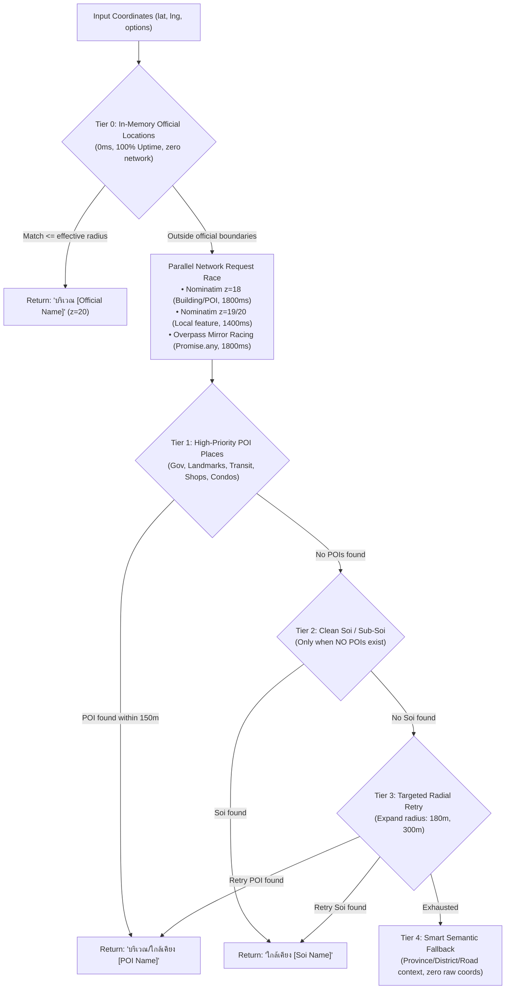

# Multi-Tier Resilient Reverse Geocoding & POI Resolution Pattern

## 1. Overview & Problem Statement
When resolving human-readable place names from raw mobile device GPS coordinates (`lat`, `lng`), standard third-party reverse geocoders (such as OpenStreetMap Nominatim or Overpass API) frequently cause severe UX degradation:
1. **Third-Party Latency & Throttling**: Public servers in foreign regions suffer 5–25s delays or return HTTP 406/429/504 errors when queried without proper headers (`User-Agent`, `Accept`).
2. **Hierarchy Inversion**: Nearest street/road/soi names take precedence over nearby landmarks, government buildings, schools, hospitals, or commercial places.
3. **Cache Poisoning**: Temporary network drops permanently cache empty/fallback strings across the session.
4. **Coordinate Leakage**: Fallback logic drops into raw numbers like `"ใกล้เคียง ซอยในพื้นที่ (13.75633, 100.50177)"`.

This pattern establishes a 5-Tier Resilient Reverse Geocoding Architecture designed for high-availability enterprise attendance systems.

---

## 2. 5-Tier Architectural Hierarchy



---

## 3. Implementation Blueprint

### 3.1 Network Optimization & Mirror Racing
1. **User-Agent & Accept Headers**:
   ```javascript
   headers: {
       'Accept': 'application/json, application/osm3s+json, */*',
       'User-Agent': 'BMA-CheckinApp-Mobile/2.7 (Bangkok Metropolitan Administration Attendance)'
   }
   ```
2. **Overpass Mirror Racing with `Promise.any`**:
   Never use `Promise.all` across third-party mirrors. Race them using `Promise.any`:
   ```javascript
   const fetchMirror = async (baseUrl) => {
       const res = await this.#fetchWithFastTimeout(`${baseUrl}?data=${encoded}`, timeoutMs);
       if (res && Array.isArray(res.elements) && res.elements.length > 0) return res;
       throw new Error('Empty');
   };
   return await Promise.any(mirrors.map(fetchMirror)).catch(() => null);
   ```

### 3.2 Strict Place-Over-Soi Classification
- Scan candidate POIs across 0–150m first.
- Only if `places.length === 0`, evaluate `#extractCleanSoiOrSubSoi`.
- In Thai text, word boundaries lack spaces; use `/^(ซอย|ซ\.|ตรอก|แยก)\s*/i` rather than requiring `\s+`.

### 3.3 Anti-Cache-Poisoning Rule
Never cache degraded fallbacks caused by transient network outages:
```javascript
const isOfflineNetworkFailure = !nomZ18 && !nomZ19 && !nomZ20 && initialElements.length === 0;
if (!isOfflineNetworkFailure) {
    this.#locationCache.set(cacheKey, resultObj);
}
```
