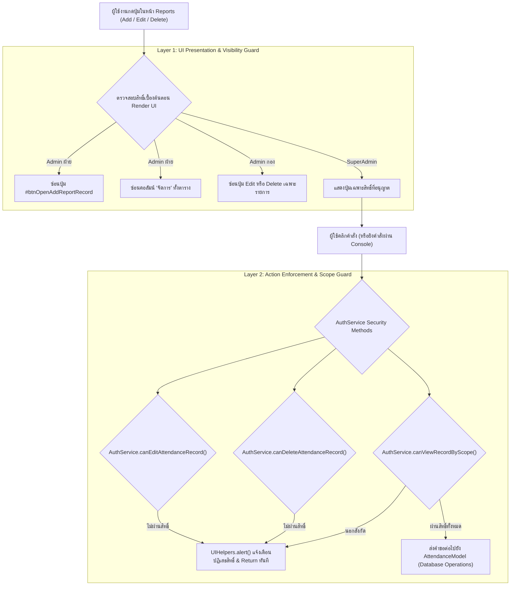

# ADR-003: สถาปัตยกรรม Double-Layer RBAC 3 ระดับ ในระบบควบคุมสิทธิ์และรายงานการลงเวลา

## 1. บริบทและปัญหา (Context & Problem Statement)
ในระบบลงเวลาปฏิบัติราชการ (BMA Check-in App) เดิมมีบทบาทผู้ใช้งานหลักเพียง 2 กลุ่มระดับบริหาร คือ `SuperAdmin` (ผู้ดูแลระบบสูงสุด) และ `Admin` (ผู้ดูแลทั่วไป) โดยในหน้าออกรายงานการลงเวลา (`reports.html` / `ReportsController.js`):
1. **ปัญหาการจัดการสิทธิ์ไม่สอดคล้องกับสายการบังคับบัญชาจริงของ กทม.:** 
   - `SuperAdmin`: ควรมีสิทธิ์เต็มทุกประการ (เพิ่ม / แก้ไข / ลบ ข้อมูลการลงเวลาของทุกหน่วยงาน)
   - `Admin กอง / สำนัก` (`role='Admin'` ที่มี `visibility_level !== 'division'` เช่น `bureau` หรือ `all`): เป็นผู้ดูแลระดับกองที่ต้องจัดการเวลาให้ข้าราชการ/ลูกจ้างในกองได้ (เพิ่ม/แก้ไขได้) แต่ **"ห้ามลบ"** ข้อมูลการลงเวลาเด็ดขาดเพื่อป้องกันประวัติสูญหาย
   - `Admin ฝ่าย / ส่วน` (`role='Admin'` ที่มี `visibility_level === 'division'`): เป็นผู้ดูแลระดับฝ่าย มีหน้าที่ตรวจสอบติดตามสถิติเท่านั้น ต้องเป็นสิทธิ์ **Read-Only** (ห้ามเพิ่ม, ห้ามแก้ไข, ห้ามลบ)
2. **ความเสี่ยงด้านความปลอดภัย (Client-Side Only Tampering):** หากควบคุมการแสดงผลเพียงแค่ซ่อนปุ่มบน HTML UI (Layer 1) ผู้ใช้งานที่มีความรู้ด้านเทคนิคอาจเปิด DOM Inspector หรือเรียก Method ผ่าน JavaScript Console เพื่อแก้ไขหรือลบข้อมูลได้ จึงจำเป็นต้องมีระบบความปลอดภัยแบบ Double-Layer Security Guard

## 2. โครงสร้างทางเทคนิคและสถาปัตยกรรม (Technical Specification & Architecture)

### 2.1 โครงสร้างระดับสิทธิ์ 3 ระดับ (3-Tier RBAC Hierarchy)
| ลำดับ | บทบาท (Role & Scope) | นิยามทางโค้ด | สิทธิ์การเข้าถึงใน Reports | สิทธิ์เพิ่ม (Add) | สิทธิ์แก้ไข (Edit) | สิทธิ์ลบ (Delete) |
|---|---|---|---|:---:|:---:|:---:|
| 1 | **SuperAdmin** | `role === 'SuperAdmin'` | ดูข้อมูลได้ทุกหน่วยงานทั่วทั้งระบบ | ✅ ได้ | ✅ ได้ | ❌/✅ ได้ (เฉพาะตน) |
| 2 | **Admin กอง/สำนัก** | `role === 'Admin' && visibility_level !== 'division'` | ดูเฉพาะบุคลากรในสำนักงาน/กองตนเอง | ✅ ได้ | ✅ ได้ (เฉพาะในสังกัด) | ❌ **ห้ามลบเด็ดขาด** |
| 3 | **Admin ฝ่าย/ส่วน** | `role === 'Admin' && visibility_level === 'division'` | ดูเฉพาะบุคลากรในฝ่ายตนเอง | ❌ **Read-Only** | ❌ **Read-Only** | ❌ **Read-Only** |

### 2.2 สถาปัตยกรรมความปลอดภัย 2 ชั้น (Double-Layer Security Guard)



### 2.3 การนำไปใช้งานใน Core AuthService (`assets/js/core/AuthService.js`)
เพิ่ม Static Methods ที่เป็น Single Source of Truth สำหรับตรวจสอบสิทธิ์การจัดการ Attendance:
```javascript
static canEditAttendanceRecord(currentUser, record = null) {
    if (!currentUser) return false;
    if (currentUser.role === 'SuperAdmin') return true;
    if (currentUser.role === 'Admin') {
        // Admin ขอบเขต สำนักงาน/กอง สามารถแก้ไขข้อมูลได้ในสังกัด
        if (currentUser.visibility_level === 'bureau' || currentUser.visibility_level === 'all') {
            return record ? AuthService.canViewRecordByScope(currentUser, record) : true;
        }
        // Admin ขอบเขต ส่วน/ฝ่าย ไม่สามารถแก้ไขได้
        return false;
    }
    return false;
}

static canDeleteAttendanceRecord(currentUser, record = null) {
    if (!currentUser) return false;
    // เฉพาะ SuperAdmin เท่านั้นที่สามารถลบข้อมูลการลงเวลาได้
    if (currentUser.role === 'SuperAdmin') return true;
    // Admin ทุกระดับ (ทั้ง กอง และ ฝ่าย) ลบไม่ได้เด็ดขาด
    return false;
}
```

### 2.4 การนำไปใช้งานใน Controller (`assets/js/controllers/ReportsController.js`)
1. **การคำนวณ Flag ประจำ Controller:**
   ```javascript
   this.isSuperAdmin = this.currentUser.role === 'SuperAdmin';
   this.isAdminBureau = this.currentUser.role === 'Admin' && this.currentUser.visibility_level !== 'division';
   this.isAdminDivision = this.currentUser.role === 'Admin' && this.currentUser.visibility_level === 'division';
   this.canAddRecord = this.isSuperAdmin || this.isAdminBureau;
   this.canManageRecords = this.isSuperAdmin || this.isAdminBureau;
   ```
2. **การป้องกัน Layer 1 (UI Presentation):**
   - ปุ่ม `btnOpenAddReportRecord` ถูกซ่อนสำหรับ Admin ฝ่าย (`btnAdd.classList.toggle('hidden', !this.canAddRecord)`)
   - หัวตารางคอลัมน์ `"จัดการ"` ถูกสลับเปิด/ปิดอัตโนมัติ `${this.canManageRecords ? '<th class="w-24 text-center no-print">จัดการ</th>' : ''}`
   - คอลัมน์ `colSpan` ของแถวกรณีไม่มีข้อมูล ปรับจาก 8 เหลือ 7 อัตโนมัติเมื่อคอลัมน์จัดการถูกซ่อน
   - ปุ่มลบในแถวจะเรนเดอร์เฉพาะ `AuthService.canDeleteAttendanceRecord(this.currentUser, rec)` (เฉพาะ SuperAdmin)
3. **การป้องกัน Layer 2 (Action Enforcement):**
   - ใน Event Listener `edit-record`: เรียกตรวจสอบ `AuthService.canEditAttendanceRecord(this.currentUser, rec)` หากไม่ผ่านจะ Alert และ Return ทันที
   - ใน Event Listener `delete-record`: เรียกตรวจสอบ `AuthService.canDeleteAttendanceRecord(this.currentUser)`
   - ใน `#handleSaveReportRecord()`: ป้องกันการบันทึกข้ามสังกัดโดยใช้ `AuthService.canViewRecordByScope()` ซ้ำอีกชั้นหนึ่งก่อนส่งบันทึก

## 3. ข้อควรระวังและกรณีศึกษา (Pitfalls & Edge Cases)
1. **การคำนวณ `colSpan` ของ Empty State Table:**
   - เมื่อซ่อนคอลัมน์ `"จัดการ"` สำหรับ Admin ฝ่าย หากคง `colspan="8"` โครงสร้างตารางจะเพี้ยนเกินออกมา 1 ช่อง ต้องคำนวณแบบยืดหยุ่น: `const colSpan = (forPrintPdf || !this.canManageRecords) ? 7 : 8;`
2. **การกรอง Dropdown บุคลากรใน Modal เพิ่มข้อมูล:**
   - ใน `#populatePersonnelDropdown()` ต้องกรองเฉพาะบุคลากรที่ Admin ผู้นั้นมีสิทธิ์ดูแลผ่าน `AuthService.canViewRecordByScope(this.currentUser, p)` เพื่อป้องกันไม่ให้ Admin กองเลือกบันทึกเวลาให้บุคลากรนอกกองของตนเอง
3. **การหลอกส่ง Request บันทึกเวลา:**
   - การตรวจสอบต้องทำทั้งขาเปิด Modal และขาบันทึก (`#handleSaveReportRecord`) เสมอ ป้องกันการแก้ `personnel_id` ใน Dropdown ผ่าน DevTools

## 4. ความเชื่อมโยงในระบบความรู้ (Knowledge Graph Links)
- เชื่อมโยงกับสถาปัตยกรรมหลัก: [[checkinapp_project_context]]
- เชื่อมโยงกับสารบัญกระบวนการ: Flow ID `FLOW_AUTH_01` (การยืนยันตัวตนและ Session) และ `FLOW_REPORTS_01` (ระบบรายงานและการจัดการเวลา)
- เชื่อมโยงกับ ADR อื่น: [[adr_001_vscode_surgical_codebase_map]]
