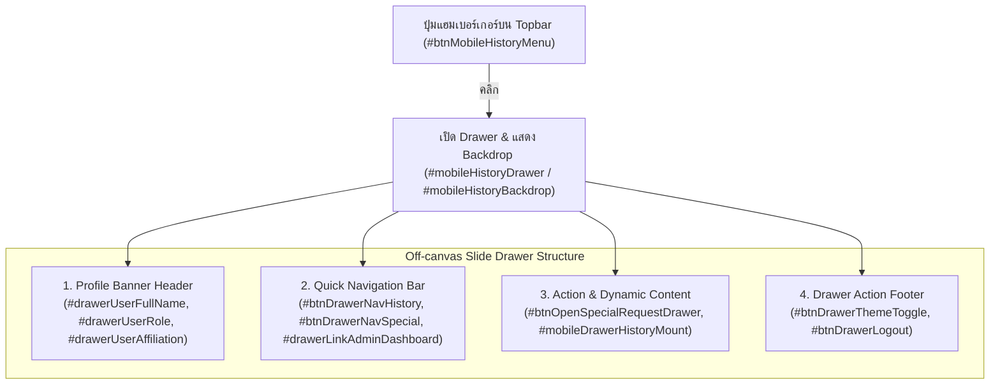

# ADR-004: สถาปัตยกรรม Off-canvas Slide Drawer และ Zero-Scroll Viewport Lock บน checkin.html

## 1. บริบทและปัญหา (Context & Problem Statement)
ในหน้าลงเวลาปฏิบัติราชการบนสมาร์ตโฟน (`checkin.html`):
1. **ปัญหาการเลื่อนหน้าจอเกินจำเป็น (Viewport Scroll Leakage):** แม้ใน ADR-002 จะมีการริเริ่มปุ่ม Sticky และ Drawer แต่หน้าจอยังคงเลื่อนไถลได้บนมือถือเมื่อเปิดกล้องถ่ายภาพ ทำให้ปุ่มลงเวลาและข้อมูลนาฬิกาไม่อยู่ในระดับสายตาที่เสถียร
2. **ความสูงของช่องแสดงกล้อง (Camera Viewport Consumption):** กรอบพรีวิวกล้องแนวตั้ง 3:4 เดิมไม่มีการจำกัดเพดานความสูง (`max-height`) ส่งผลให้กินพื้นที่แนวตั้งบนสมาร์ตโฟนจอ 16:9 หรือ 19.5:9 เกินไปจนดันปุ่มลงเวลาตกขอบล่าง
3. **การเข้าถึงเมนูผู้ใช้และการตั้งค่าส่วนตัวบนมือถือ:** ผู้ใช้งานมือถือจำเป็นต้องเข้าถึงการสลับธีมถนอมสายตา (Dark Mode), การออกจากระบบ, การข้ามไประบบผู้ดูแล (Admin), และการดูประวัติ โดยไม่เกะกะหน้าจอหลัก
4. **ความเสี่ยงการพังทลายของระบบ JavaScript Controller (DOM Contract Invariance):** `CheckinController.js` ผูกมัดกับ DOM ID อย่างเข้มงวด หากปรับแต่ง HTML แล้วทำ DOM ID ใดหลุดหาย แม้เพียงจุดเดียว จะทำให้ Controller เกิด Exception และหน้าจอค้างทันที (เช่นในบทเรียน V22)

## 2. โครงสร้างทางเทคนิคและสถาปัตยกรรม (Technical Specification & Architecture)

### 2.1 สถาปัตยกรรม No-Scroll Viewport Lock (`assets/css/bma-theme.css`)
ใช้เทคนิค Modern CSS Viewport Units (`100dvh`) เพื่อรองรับ Dynamic URL Bar ของเบราว์เซอร์มือถือ (iOS Safari & Chrome Mobile):

```css
@media (max-width: 1023px) {
    body.checkin-viewport-lock {
        min-height: 100dvh;
        max-height: 100dvh;
        overflow-x: hidden;
        overflow-y: auto;
        -webkit-overflow-scrolling: touch;
    }
}
@media (min-width: 1024px) {
    body.checkin-viewport-lock {
        height: 100dvh;
        max-height: 100dvh;
        overflow: hidden;
    }
    body.checkin-viewport-lock main {
        height: calc(100dvh - 105px);
        max-height: calc(100dvh - 105px);
        overflow-y: auto;
    }
}

/* ควบคุมเพดานความสูงกล้อง 3:4 บนมือถือไม่ให้เกิน 220px */
.camera-portrait-3-4 {
    width: 100%;
    max-width: 300px;
    max-height: 220px;
    aspect-ratio: 3 / 4;
    margin-left: auto;
    margin-right: auto;
}
```

### 2.2 โครงสร้าง Off-canvas Slide Drawer (`checkin.html` & `CheckinController.js`)
สถาปัตยกรรม Drawer แบบโมดูลาร์แบ่งเป็น 4 โซนชัดเจน:



1. **Profile Header:** แสดงชื่อเต็มของผู้ลงเวลา, บทบาท, และสังกัดระดับสำนัก/ฝ่าย
2. **Quick Navigation Bar:** ปุ่มสลับดูประวัติเวลา, ประวัติคำขอพิเศษ, และลิงก์ไประบบผู้ดูแล (ซ่อนไว้สำหรับ User ทั่วไป แสดงเฉพาะ SuperAdmin/Admin)
3. **Scrollable Content Body:**
   - แบนเนอร์สีครามสำหรับยื่นคำขอกรณีพิเศษ (`#btnOpenSpecialRequestDrawer`)
   - จุด Mount ตารางประวัติส่วนตัว (`#mobileDrawerHistoryMount`)
4. **Drawer Sticky Footer:**
   - ปุ่มสลับโหมดถนอมสายตา (`#btnDrawerThemeToggle`) ซิงค์ไอคอนและข้อความเรียลไทม์ผ่าน `#updateThemeButtonUI()`
   - ปุ่มออกจากระบบ (`#btnDrawerLogout`) ยืนยันผ่าน SweetAlert2 ก่อนเคลียร์ Session

### 2.3 กฎการรักษา DOM Contract Invariance (98 DOM IDs)
การปรับเลย์เอาต์หน้า `checkin.html` ต้องรับประกันว่า DOM IDs ทั้งหมดที่มีการอ้างอิงใน `CheckinController.js` จะต้องคงอยู่ครบถ้วน 100%:
- **ข้อมูลผู้ใช้และการตั้งค่า:** `userFullNameText`, `userAffiliationText`, `userRoleBadge`, `headerOrgName`, `footerCheckinOrg`, `footerCheckinBureau`, `footerCheckinDesc`, `liveDateDisplay`, `liveClockDisplay`
- **ระบบกล้องและ GPS:** `cameraSectionCard`, `videoPreview`, `cameraCaptureCanvas`, `photoResultPreview`, `photoCaptureOverlay`, `btnStartCamera`, `btnCapturePhoto`, `btnRetakePhoto`, `gpsSectionCard`, `gpsStatusBadge`, `gpsAccuracyBadge`, `gpsAddressDisplay`, `btnRefreshGps`
- **การลงเวลาและกะเวลา:** `checkinActionCard`, `btnMainCheckin`, `btnMainCheckinText`, `btnMainCheckinSubtext`, `btnMainCheckinIcon`, `shiftSelect`, `chkSingleClickCheckout`, `quickSummaryCheckinTime`, `quickSummaryCheckoutTime`
- **ระบบ Drawer และแท็บ:** `mobileHistoryDrawer`, `mobileHistoryBackdrop`, `btnMobileHistoryMenu`, `btnCloseMobileHistory`, `btnDrawerNavHistory`, `btnDrawerNavSpecial`, `drawerLinkAdminDashboard`, `drawerUserFullName`, `drawerUserRole`, `drawerUserAffiliation`, `btnDrawerThemeToggle`, `btnDrawerLogout`, `drawerThemeIcon`, `drawerThemeLabel`
- **Modal และแบบฟอร์มคำขอพิเศษ:** `modalSpecialRequest`, `spWorkDateInput`, `spShiftSelect`, `spCheckinTimeInput`, `spCheckoutTimeInput`, `spReasonInput`, `spRemarkSelect`

## 3. ข้อควรระวังและกรณีศึกษา (Pitfalls & Edge Cases)
1. **ป้องกันหน้าเลื่อนบน iOS Safari:**
   - การกำหนด `height: 100vh` จะมีปัญหากับ Navigation Bar ของ Safari ที่หด/ขยายได้ การใช้ `100dvh` ควบคู่กับ `overflow-y: auto; -webkit-overflow-scrolling: touch;` ใน CSS Utility จะช่วยแก้ปัญหานี้ได้อย่างสมบูรณ์
2. **การอัปเดตสถานะปุ่มธีมทั้ง 2 จุด:**
   - ใน `CheckinController.#updateThemeButtonUI()` ต้องอัปเดตทั้งปุ่มบน Desktop Header (`themeToggleBtn`) และปุ่มใน Drawer Footer (`btnDrawerThemeToggle`) พร้อมกัน มิฉะนั้นไอคอนพระจันทร์/พระอาทิตย์จะแสดงผลไม่ตรงกัน
3. **การเปิด Modal ทับซ้อนกับ Drawer:**
   - เมื่อผู้ใช้กดปุ่มยื่นคำขอพิเศษจากใน Drawer (`#btnOpenSpecialRequestDrawer`) ต้องปิด Drawer ก่อน (`#closeMobileHistoryDrawer()`) แล้วจึงเปิด `modalSpecialRequest` เพื่อไม่ให้ z-index ของฉากหลังชนกัน

## 4. ความเชื่อมโยงในระบบความรู้ (Knowledge Graph Links)
- เชื่อมโยงกับสถาปัตยกรรมก่อนหน้า: [[adr_002_mobile_checkin_sticky_drawer]]
- เชื่อมโยงกับเหตุการณ์แก้ไขบั๊ก: [[fix_v22_checkin_loading_hang_92_percent]]
- เชื่อมโยงกับสารบัญกระบวนการ: Flow ID `FLOW_CHECKIN_01` (การลงเวลามา-กลับ) และ `FLOW_LAYOUT_01` (โครงสร้างหน้าจอและ Responsive Layout)
