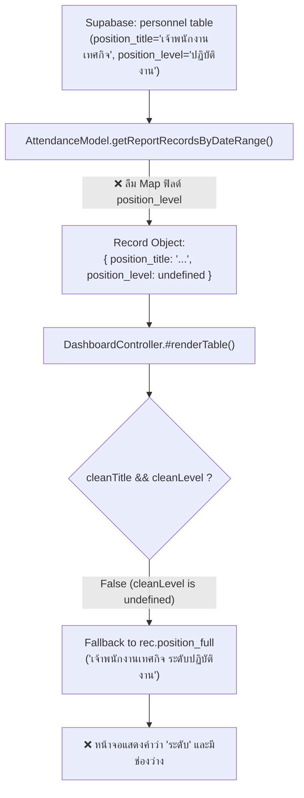

# Post-mortem: แก้ไข Root Cause คีย์ position_level ตกหล่นใน AttendanceModel

## 1. บริบทและอาการของปัญหา (Context & Symptoms)
ในหน้ากระดานสรุปสถิติประจำวัน (`dashboard.html` ควบคุมโดย `DashboardController.js`):
- **อาการที่พบ:** ในตารางสรุปการปฏิบัติราชการประจำวัน คอลัมน์ตำแหน่งยังคงแสดงผลเป็นข้อความที่มีคำว่า `"ระดับ"` หรือมีการเว้นวรรค เช่น `"เจ้าพนักงานเทศกิจ ระดับปฏิบัติงาน"` แทนที่จะแสดงชื่อตำแหน่งและระดับชิดติดกันตามมาตรฐาน กทม. คือ `"เจ้าพนักงานเทศกิจปฏิบัติงาน"`
- **ความผิดปกติเชิงโค้ด:** แม้โค้ดใน `DashboardController.js` จะมีตรรกะ `${cleanTitle}${cleanLevel}` เตรียมไว้แล้ว แต่ระบบกลับข้ามตรรกะนี้และไปเรียกใช้ฟิลด์สำรอง `rec.position_full` เสมอ

## 2. การวิเคราะห์หาสาเหตุรากเหง้า (Root Cause Analysis - RCA)
จากการตรวจสอบสายการส่งผ่านข้อมูล (Data Pipeline & Model Layer) ใน `AttendanceModel.js`:
1. ใน Method `AttendanceModel.getReportRecordsByDateRange()` (ซึ่งเป็นฟังก์ชันต้นน้ำในการสร้างชุดข้อมูลรายงานและ Dashboard):
   ```javascript
   // โค้ดเดิมใน AttendanceModel.js
   return {
       row_uid: `${person.id}_${targetDate}`,
       personnel_id: person.id,
       full_name: `${person.prefix}${person.first_name} ${person.last_name}`,
       position_type: person.position_type,
       position_title: person.position_title,
       // ตกหล่น: ขาด position_level: person.position_level !
       position_full: (() => { ... })(),
       ...
   };
   ```
2. **กลไกความผิดพลาด:**
   - เมื่อ `position_level` ไม่ได้ถูกส่งออกมาใน Object ทำให้ใน `DashboardController.js` ตัวแปร `rec.position_level` มีค่าเป็น `undefined`
   - เมื่อ `cleanLevel` กลายเป็นสตริงว่าง `""` เงื่อนไข `(cleanTitle && cleanLevel)` จึงประเมินเป็น `false`
   - ระบบจึงตกไปที่เงื่อนไข Fallback ตัวสุดท้ายคือ `rec.position_full || '-'`
   - และเนื่องจาก `position_full` ดั้งเดิมในฐานข้อมูลมีคำว่า `"ระดับ "` ติดอยู่ จึงส่งผลให้ข้อความที่ไม่พึงประสงค์หลุดออกไปสู่หน้าจอผู้ใช้งาน



## 3. การแก้ไขและการป้องกัน (Resolution & Defense-in-Depth)

### 3.1 การแก้ไขที่ต้นน้ำ (Root Cause Fix in Model)
ใน `assets/js/models/AttendanceModel.js` ได้เพิ่มคีย์ `position_level` เข้าสู่ Object อย่างสมบูรณ์:
```javascript
full_name: `${person.prefix}${person.first_name} ${person.last_name}`,
position_type: person.position_type,
position_title: person.position_title,
position_level: person.position_level, // ✅ เพิ่มคีย์ที่ตกหล่น
position_full: (() => {
    const cleanTitle = (person.position_title || '').trim();
    const cleanLevel = (person.position_level || '').replace(/^ระดับ\s*/, '').trim();
    return (cleanTitle && cleanLevel) ? `${cleanTitle}${cleanLevel}` : (cleanTitle || cleanLevel || '-');
})(),
```

### 3.2 การป้องกันแบบสองชั้นที่ปลายน้ำ (Defense-in-Depth in Controllers)
ใน `DashboardController.js` และ `ApprovalsController.js` ได้ปรับปรุงตรรกะ Fallback ให้ทำการคลีนคำว่า `"ระดับ"` ออกเสมอแม้ในกรณีที่ต้องใช้ `position_full`:
```javascript
const cleanTitle = (rec.position_title || '').trim();
const cleanLevel = (rec.position_level || '').replace(/^ระดับ\s*/, '').trim();
const mergedPosition = (cleanTitle && cleanLevel) 
    ? `${cleanTitle}${cleanLevel}` 
    : (cleanTitle || cleanLevel || (rec.position_full || '').replace(/\s*ระดับ\s*/g, '').trim() || '-');
```

## 4. ผลลัพธ์และการทดสอบ (Verification)
- ตารางใน `dashboard.html` แสดงชื่อตำแหน่งและระดับติดกันอย่างถูกต้อง 100% เช่น `"เจ้าพนักงานเทศกิจปฏิบัติงาน"`, `"นิติกรชำนาญการ"`
- ขจัดคำว่า `"ระดับ"` และช่องว่างที่รบกวนสายตาออกได้หมดจดทั่วทั้งระบบ
- ไม่กระทบต่อการส่งออกรายงาน Excel หรือการพิมพ์เอกสารราชการ

## 5. ความเชื่อมโยงในระบบความรู้ (Knowledge Graph Links)
- เชื่อมโยงกับกฎการจัดรูปแบบตำแหน่ง: [[rule_compact_action_buttons_and_approvals]]
- เชื่อมโยงกับสถาปัตยกรรมภาพรวม: [[checkinapp_project_context]]
- เชื่อมโยงกับกระบวนการทำงาน: Flow ID `FLOW_DASHBOARD_01` (Dashboard และสถิติประจำวัน)
